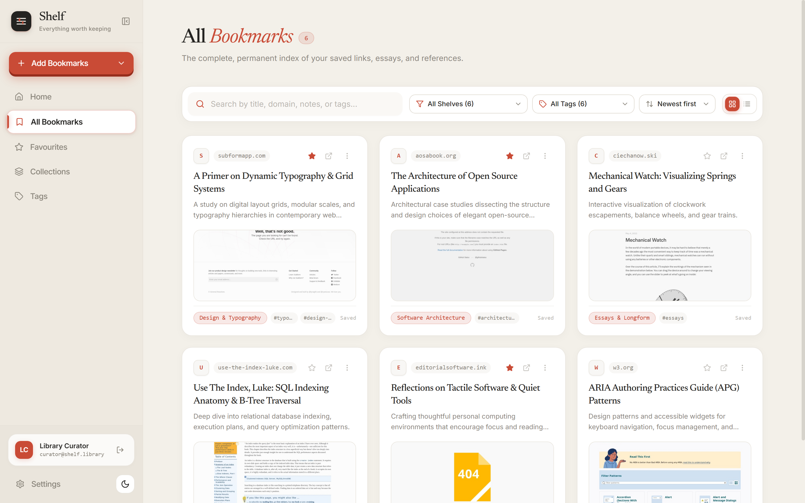
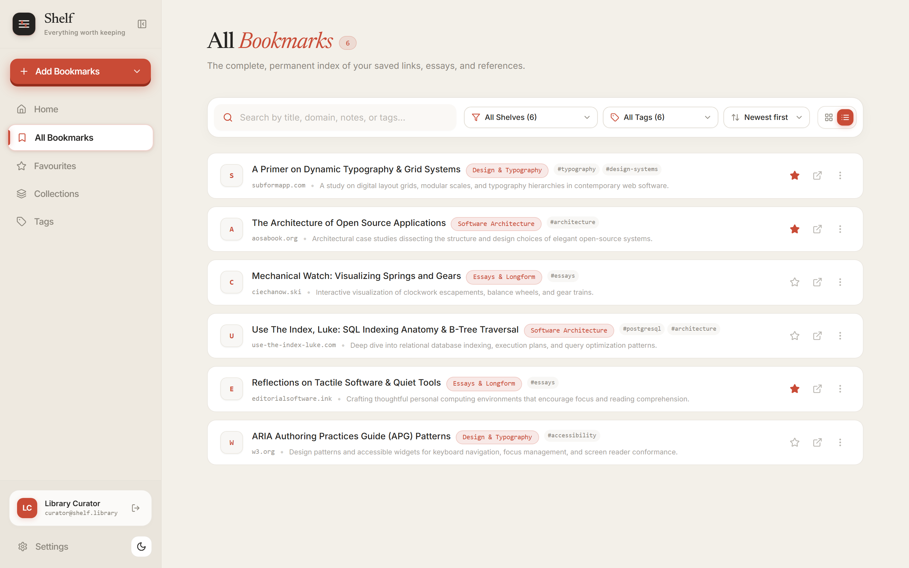
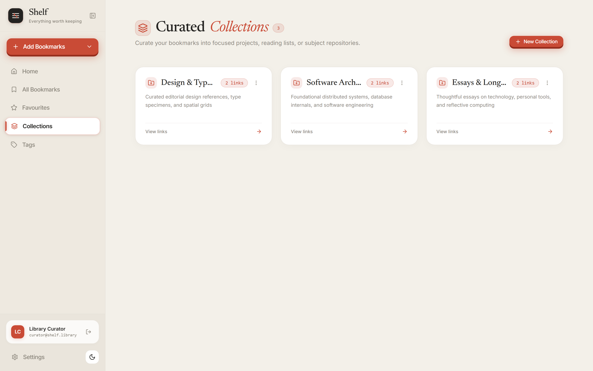
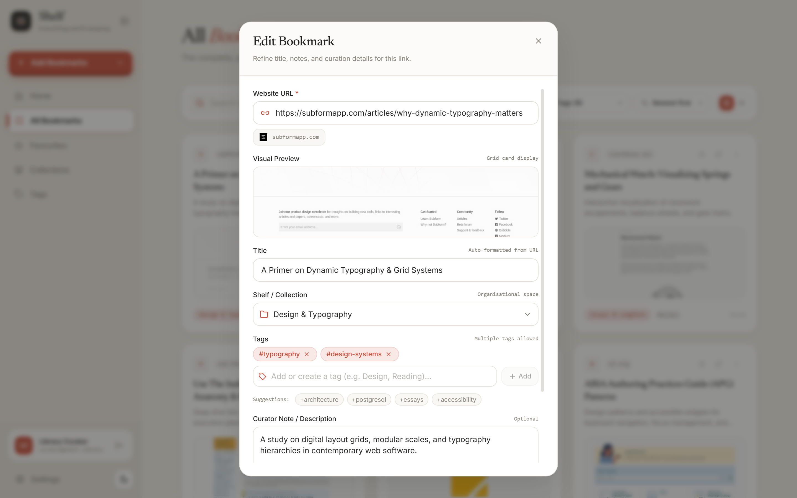
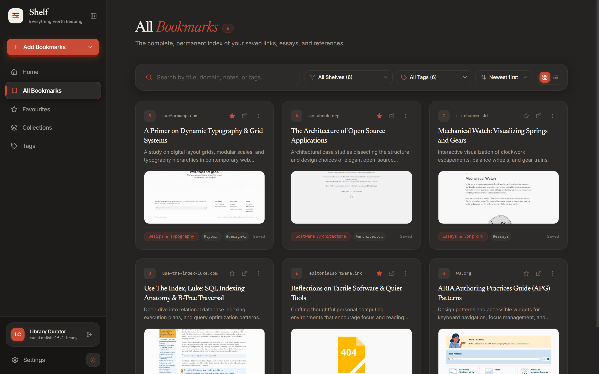
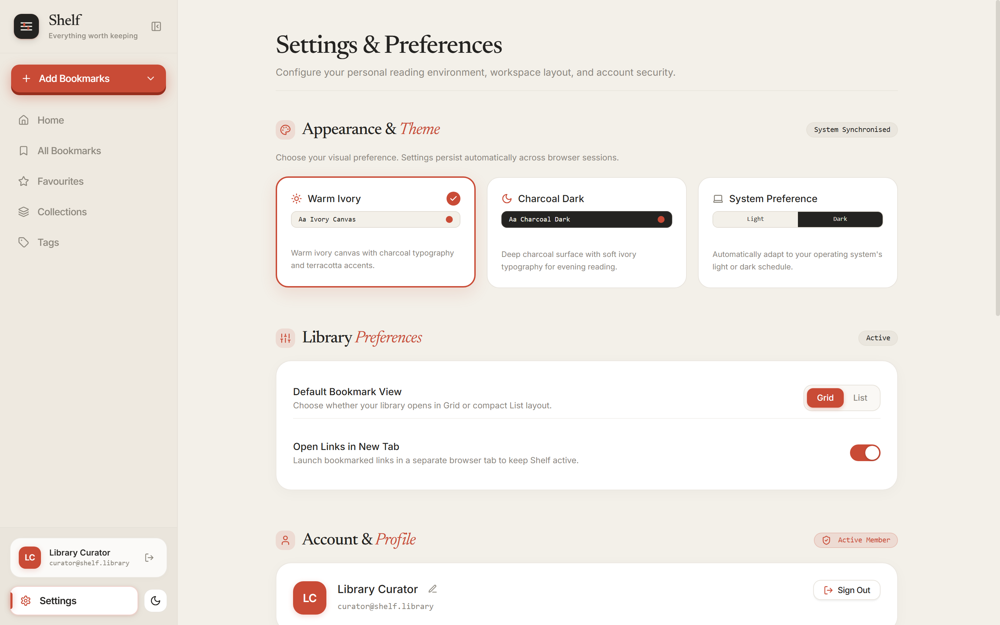

# Shelf

> **Everything worth keeping.**

Shelf is a distraction-free, personal bookmark manager and digital reading repository. Designed with an editorial aesthetic, Shelf provides a tactile, focused workspace for curating links, technical references, documentation, and research articles without algorithmic noise.

[](https://shelf.gopalakrishnavarna2004.workers.dev)
[](https://github.com/gopalakrishna2004/Shelf)
[](./LICENSE)

---

## Overview

Shelf replaces sprawling, unorganized browser bookmarks with a focused digital library. Every bookmark is stored with rich metadata, custom tags, and collection groupings in an authoritative PostgreSQL database backed by Row Level Security.



---

## Key Features

- **Tactile Editorial Interface**: Designed with warm ivory (`#F3F0E9`), deep charcoal (`#242321`), and terracotta (`#C94B36`) accents, pairing editorial serif headings with crisp monospace tags.
- **Dual View Modes**: Switch seamlessly between a visual **Card Grid** with custom domain monogram plaques and an ultra-dense **List View** for high-volume browsing.
- **Curated Collections & Tags**: Organize reading items into distinct shelves (e.g., *Systems Engineering*, *Interface Design*, *Longform Essays*) alongside orthogonal, multi-value labels.
- **Real-Time Search & Filtering**: Multi-condition filtering across text search, collections, and tags with instant query evaluation.
- **Deterministic Ordering**: Sort items by date added (newest/oldest) or lexicographically by title (A–Z / Z–A) with deterministic secondary tie-breaking.
- **Adaptive Theme System**: Full support for Light, Dark (charcoal background with muted terracotta accents), and System preference modes with persistent state and zero layout flash.
- **Accessibility & Focus Trapping**: Keyboard-navigable modal dialogs, accessible ARIA attributes, semantic structure, and accessible action menus.
- **Cloud-Authoritative Persistence**: Built on Supabase PostgreSQL with strict tenant-isolated Row Level Security (RLS) policies.
- **Dedicated Account Lifecycle**: Self-serve password reset flows, secure credential updates, and verified single-user account deletion via an isolated Supabase Edge Function.

---

## Interface Tour

### Bookmark Library — List View
A high-density tabular layout optimized for quick scanning, keyboard selection, and large archives.



### Curated Collections
Group bookmarks into themed shelves with custom color badges, descriptions, and dynamic item counters.



### Add & Edit Bookmark Modal
Tactile modal dialog for saving links, specifying custom titles and descriptions, assigning collections, and attaching tags.



### Dark Theme
An eye-friendly charcoal and muted-slate dark mode designed for deliberate nighttime reading sessions.



### Settings & Account Preferences
Centralized management for appearance preferences, reading behaviors, security sessions, and account lifecycle controls.



---

## Technology Stack

| Layer | Technology | Description |
| :--- | :--- | :--- |
| **Frontend Framework** | [React 19](https://react.dev/) | Modern concurrent UI architecture |
| **Language** | [TypeScript 5.7](https://www.typescriptlang.org/) | Strict static typing across components and domain models |
| **Build & Dev Tooling** | [Vite 6](https://vitejs.dev/) | Fast Hot Module Replacement and optimized asset bundling |
| **Styling** | [Tailwind CSS 3.4](https://tailwindcss.com/) | Custom design tokens and tactile editorial utility classes |
| **Iconography** | [Lucide React](https://lucide.dev/) | Clean, accessible vector icons |
| **Database & Auth** | [Supabase](https://supabase.com/) | PostgreSQL with Row Level Security, Auth with PKCE flow |
| **Serverless Functions** | [Supabase Edge Functions](https://supabase.com/docs/guides/functions) | Deno-based secure backend function for account deletion |
| **Production Hosting** | [Cloudflare Workers](https://workers.cloudflare.com/) | Global edge distribution via Static Assets |
| **Test Suite** | [Vitest 5.1](https://vitest.dev/) | Fast unit and integration tests (32 suites, 410 tests) |

---

## System Architecture

Shelf adopts a secure, online-only cloud architecture:

```
[ Client Browser ]
        │
        ├── Client-Side Hash Routing (#all, #collections, #tags, #settings)
        ├── Repository Layer (IBookmarkRepository, ICollectionRepository, ITagRepository)
        │
        ▼ (HTTPS REST / Bearer JWT)
[ Supabase Managed Backend ]
        │
        ├── PostgreSQL Database (Multi-tenant RLS enforcement)
        ├── Supabase Auth (PKCE session tokens in storage)
        └── Edge Functions (delete-account worker with origin & token validation)
```

1. **Client-Side Hash Routing**: Standard hash fragments eliminate 404 routing errors on static edge networks while preserving direct link navigation.
2. **Repository Abstraction**: All database interactions pass through decoupled interfaces, isolating UI logic from backend implementation details.
3. **Multi-Tenant Security**: Every query is evaluated under the authenticated caller's JWT; PostgreSQL RLS policies guarantee users can only read and write their own records.
4. **Isolated Administrative Actions**: Sensitive operations (e.g. permanent user deletion via admin APIs) execute solely inside authenticated Supabase Edge Functions with strict CORS origin verification.

---

## Getting Started

### Prerequisites

- [Node.js](https://nodejs.org/) (v18.0.0 or higher recommended)
- [npm](https://www.npmjs.com/) (bundled with Node.js)
- A [Supabase](https://supabase.com/) project

### 1. Clone the Repository

```bash
git clone https://github.com/gopalakrishna2004/Shelf.git
cd Shelf
```

### 2. Install Dependencies

```bash
npm install
```

### 3. Configure Environment Variables

Create your local `.env` file based on `.env.example`:

```bash
cp .env.example .env
```

Set your Supabase configuration values:

```ini
VITE_SUPABASE_URL=https://<your-project-ref>.supabase.co
VITE_SUPABASE_PUBLISHABLE_KEY=<your-supabase-publishable-key>
```

> **Security Note:** Only publishable/anon keys belong in `.env`. Never prefix service-role keys with `VITE_` or include them in client source files.

### 4. Database Provisioning

Apply the database schema and security policies to your Supabase project:

1. Open your project in the [Supabase Dashboard](https://supabase.com/dashboard).
2. Go to the **SQL Editor**.
3. Load the migration script: [`supabase/migrations/20261118_stage5_cloud_persistence.sql`](./supabase/migrations/20261118_stage5_cloud_persistence.sql).
4. Run the script to provision the tables (`bookmarks`, `collections`, `tags`, `bookmark_tags`) and configure Row Level Security policies.

### 5. Start Local Development

```bash
npm run dev
```

The application will be accessible at `http://localhost:5174`.

---

## Development Scripts

| Command | Action |
| :--- | :--- |
| `npm run dev` | Start the local development server at `http://localhost:5174` |
| `npm test` | Run all 32 test suites and 410 unit/integration tests with Vitest |
| `npm run build` | Perform TypeScript validation (`tsc -b`) and create an optimized production bundle in `dist/` |
| `npm run preview` | Serve the production build locally for verification |

---

## Deployment Guide: Cloudflare Workers Static Assets

Shelf is deployed to production using Cloudflare Workers Static Assets.

### Step 1: Build the Static Bundle

```bash
npm run build
```

This compiles TypeScript source code and packages production assets into the `dist/` directory.

### Step 2: Configure and Deploy to Cloudflare Workers

Create a `wrangler.toml` file in the project root to configure Cloudflare Workers Static Assets:

```toml
name = "shelf"
compatibility_date = "2024-09-23"
assets = { directory = "./dist", binding = "ASSETS" }
```

Deploy the production build to Cloudflare:

```bash
npx wrangler deploy
```

### Step 3: Configure Supabase Auth Redirects

In the Supabase Dashboard under **Authentication > URL Configuration**:

- **Site URL**: `https://shelf.gopalakrishnavarna2004.workers.dev`
- **Redirect URLs**:
  - `https://shelf.gopalakrishnavarna2004.workers.dev/**`
  - `https://shelf.gopalakrishnavarna2004.workers.dev`
  - `http://localhost:5174/**` (for local development)

### Step 4: Deploy the `delete-account` Edge Function

To support permanent self-serve account deletion:

1. Ensure the Supabase CLI is authenticated:
   ```bash
   npx supabase login
   ```
2. Link your Supabase project:
   ```bash
   npx supabase link --project-ref <your-project-ref>
   ```
3. Set the allowed frontend origin secret:
   ```bash
   npx supabase secrets set APP_ORIGIN=https://shelf.gopalakrishnavarna2004.workers.dev
   ```
4. Deploy the Edge Function:
   ```bash
   npx supabase functions deploy delete-account --no-verify-jwt
   ```

   > **Why `--no-verify-jwt`?**
   > This flag permits browser CORS preflight (`OPTIONS`) requests to reach the function without being blocked by Supabase's edge gateway. Authorization is strictly enforced internally: the function validates the incoming bearer token via `supabase.auth.getUser()`, ensuring caller authenticity and deriving the user ID exclusively from the verified server identity rather than trusting client-supplied identifiers.

---

## Project Structure

```
shelf/
├── docs/
│   └── screenshots/               # Application showcase captures
│       ├── shelf-dashboard.png
│       ├── shelf-list-view.png
│       ├── shelf-collections.png
│       ├── shelf-bookmark-dialog.png
│       ├── shelf-dark-theme.png
│       └── shelf-settings.png
├── src/
│   ├── components/                # Modular UI components
│   │   ├── auth/                  # Password recovery, migration, account deletion
│   │   ├── bookmark/              # Cards, empty states, modals, action menus
│   │   ├── layout/                # Sidebar, brand identity, navigation items
│   │   └── ui/                    # Tactile buttons, inputs, modals, badges, toggles
│   ├── context/                   # React context providers (Auth, Bookmarks, Collections, Tags)
│   ├── hooks/                     # Custom hooks for theme, layout, and view state
│   ├── layouts/                   # Application shell layout
│   ├── lib/                       # Metadata parsing, search engine, sorting, Supabase client
│   ├── pages/                     # Routed view pages (All, Collections, Tags, Settings)
│   ├── services/                  # Repository implementations and error translation
│   ├── styles/                    # Global Tailwind styling and typography rules
│   └── types/                     # Shared TypeScript data contracts
├── supabase/
│   ├── functions/                 # Supabase Edge Functions (delete-account)
│   └── migrations/                # Database schemas, RLS policies, and triggers
├── .env.example                   # Environment variable template
├── LICENSE                        # MIT License
├── package.json                   # Project dependencies and scripts
├── tailwind.config.js             # Tactile color tokens and typography configuration
├── tsconfig.json                  # Strict TypeScript compiler options
└── vite.config.ts                 # Vite bundler configuration
```

---

## License

This project is licensed under the MIT License. See the [LICENSE](./LICENSE) file for details.

Copyright (c) 2026 B V Gopala Krishna Varna
