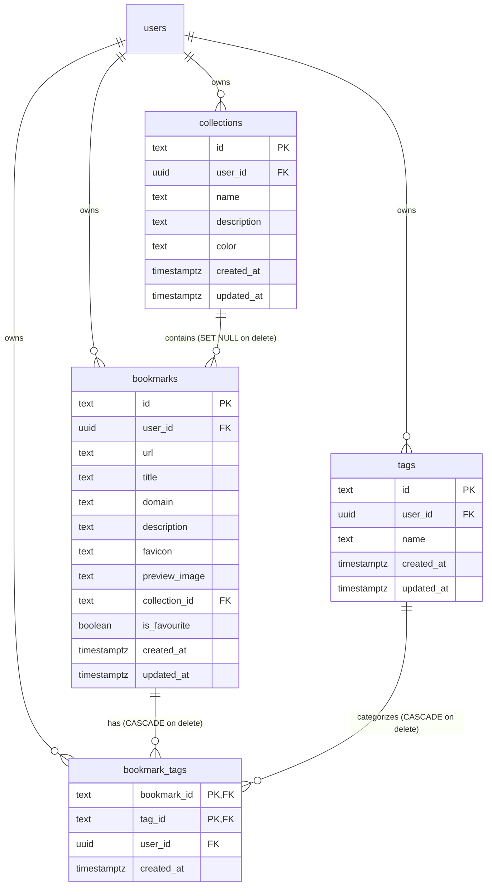
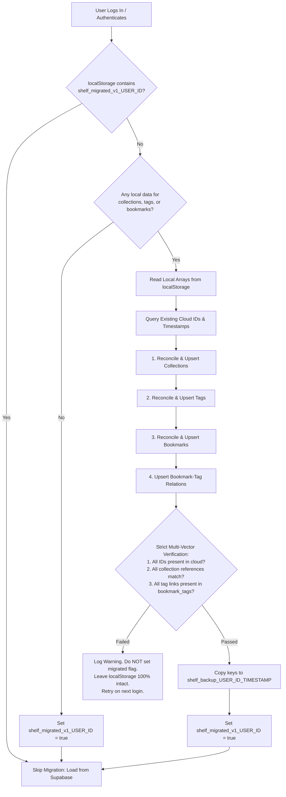

# Stage 5: Revised Online-Only Cloud Persistence Architecture

> **Project:** Shelf Bookmark Manager  
> **Status:** Final Architecture Design Specification (Ready for Task 5.1 Approval)  
> **Core Model:** Online-Only, Browser-Based Cloud Storage via Supabase PostgreSQL  

---

## 1. Executive Summary & Fundamental Product Decision

### 1.1 Product Model
Shelf is an **online-only, browser-based personal bookmark manager**. An active internet connection is required for all data access, creation, updates, and deletions. Supabase PostgreSQL is the sole authoritative cloud database for all user data.

### 1.2 Elimination of Offline-Sync Complexity
In accordance with this product decision, all previously drafted offline-sync mechanisms have been **completely eliminated**:
- ❌ **No IndexedDB local persistence layer:** Shelf does not maintain a shadow database in the browser.
- ❌ **No offline mutation queues or outbox logging:** Mutations are sent directly to Supabase via standard HTTPS REST/RPC calls.
- ❌ **No background synchronization workers or CRON schedulers:** There are no background sync tasks.
- ❌ **No snapshot/delta pagination protocols or sync cursors:** No `sync_seq`, watermark markers, cursor expiration, or 90-day retention policies.
- ❌ **No soft-delete tombstones for synchronization:** Deletions are standard transactional PostgreSQL deletes (`DELETE FROM ...`).
- ❌ **No per-user advisory locks or multi-master conflict resolution:** Standard ACID transaction semantics and database constraints handle data consistency.
- ❌ **No offline editing:** If the browser loses connectivity, operations display a clear offline notice and fail gracefully without corrupting local state.
- ❌ **No Supabase Realtime subscriptions:** Operations are standard request-driven cloud queries.

---

## 2. Current Architecture Findings (Codebase Inspection)

Inspection of the project codebase reveals:

1. **Clean Repository Abstractions:**
   - `IBookmarkRepository` in [src/services/bookmarkService.ts](file:///C:/Users/Admin/shelf/src/services/bookmarkService.ts).
   - `ICollectionRepository` in [src/services/collectionService.ts](file:///C:/Users/Admin/shelf/src/services/collectionService.ts).
   - `ITagRepository` in [src/services/tagService.ts](file:///C:/Users/Admin/shelf/src/services/tagService.ts).
   - All three services instantiate singleton repository implementations (`new LocalBookmarkRepository()`, etc.). Switching to Supabase requires providing Supabase-backed implementations of these exact interfaces.

2. **TypeScript Data Models:**
   - Defined in [src/types/index.ts](file:///C:/Users/Admin/shelf/src/types/index.ts):
     - `Bookmark`: `id`, `url`, `title`, `domain`, `description?`, `favicon?`, `previewImage?`, `collectionId?`, `collectionName?`, `tags?: string[]`, `isFavourite: boolean`, `createdAt: string`, `updatedAt?: string`.
     - `Collection`: `id`, `name`, `description?`, `color?`, `count?: number`, `createdAt: string`, `updatedAt?: string`.
     - `Tag`: `id`, `name`, `createdAt: string`, `updatedAt?: string`.
   - **Key Contract:** `Bookmark.tags` is an array of tag ID strings (`string[]`). The UI components and search engine depend on this shape.

3. **Existing LocalStorage Formats:**
   - Keys are strictly user-scoped:
     - `shelf_bookmarks_${userId}`
     - `shelf_collections_${userId}`
     - `shelf_tags_${userId}`
   - Data is stored as JSON string arrays matching the TypeScript interfaces.

4. **Supabase Client & Auth Setup:**
   - Configured in [src/lib/supabase.ts](file:///C:/Users/Admin/shelf/src/lib/supabase.ts) using `@supabase/supabase-js`.
   - Environment variables: `VITE_SUPABASE_URL` and `VITE_SUPABASE_PUBLISHABLE_KEY`.
   - Auth is handled via [src/context/AuthContext.tsx](file:///C:/Users/Admin/shelf/src/context/AuthContext.tsx) with session persistence in localStorage (`sb-${projectRef}-auth-token`).
   - Account deletion invokes a Supabase Edge Function (`delete-account`).

---

## 3. Proposed PostgreSQL Database Schema & Relational Integrity

The database consists of four standard relational tables in the `public` schema.



### 3.1 Relational Integrity & Same-User Constraints

To mathematically prevent cross-account data associations:
1. `collections`, `tags`, and `bookmarks` each maintain a composite unique constraint on `(user_id, id)`.
2. `bookmark_tags` includes `user_id` and enforces composite foreign keys `(user_id, bookmark_id)` referencing `bookmarks(user_id, id)` and `(user_id, tag_id)` referencing `tags(user_id, id)`. This physically prevents a user from linking their bookmark to another user's tag, or vice versa.
3. `bookmarks` references `collections` via composite foreign key `(user_id, collection_id) REFERENCES collections(user_id, id) ON DELETE SET NULL (collection_id)`. When a collection is deleted:
   - `collection_id` is set to `NULL`.
   - `user_id` remains unchanged and non-null.
   - The bookmark remains intact and becomes unassigned.

### 3.2 DDL Specification

```sql
-- Enable standard UUID generation if needed for future server-generated keys
CREATE EXTENSION IF NOT EXISTS "pgcrypto";

-- ============================================================================
-- 1. COLLECTIONS TABLE
-- ============================================================================
CREATE TABLE IF NOT EXISTS public.collections (
    id TEXT NOT NULL,
    user_id UUID NOT NULL REFERENCES auth.users(id) ON DELETE CASCADE,
    name TEXT NOT NULL,
    description TEXT NULL,
    color TEXT NULL,
    created_at TIMESTAMPTZ NOT NULL DEFAULT now(),
    updated_at TIMESTAMPTZ NOT NULL DEFAULT now(),
    CONSTRAINT pk_collections PRIMARY KEY (id),
    -- Required for composite same-user foreign keys
    CONSTRAINT uq_collections_user_id UNIQUE (user_id, id),
    CONSTRAINT chk_collection_name_not_empty CHECK (length(trim(name)) > 0)
);

-- Case-insensitive unique name per user
CREATE UNIQUE INDEX IF NOT EXISTS idx_collections_user_lower_name 
ON public.collections (user_id, lower(trim(name)));

CREATE INDEX IF NOT EXISTS idx_collections_user_created 
ON public.collections (user_id, created_at DESC);

-- ============================================================================
-- 2. TAGS TABLE
-- ============================================================================
CREATE TABLE IF NOT EXISTS public.tags (
    id TEXT NOT NULL,
    user_id UUID NOT NULL REFERENCES auth.users(id) ON DELETE CASCADE,
    name TEXT NOT NULL,
    created_at TIMESTAMPTZ NOT NULL DEFAULT now(),
    updated_at TIMESTAMPTZ NOT NULL DEFAULT now(),
    CONSTRAINT pk_tags PRIMARY KEY (id),
    -- Required for composite same-user foreign keys
    CONSTRAINT uq_tags_user_id UNIQUE (user_id, id),
    CONSTRAINT chk_tag_name_not_empty CHECK (length(trim(name)) > 0)
);

-- Case-insensitive unique name per user
CREATE UNIQUE INDEX IF NOT EXISTS idx_tags_user_lower_name 
ON public.tags (user_id, lower(trim(name)));

CREATE INDEX IF NOT EXISTS idx_tags_user_created 
ON public.tags (user_id, created_at DESC);

-- ============================================================================
-- 3. BOOKMARKS TABLE
-- ============================================================================
CREATE TABLE IF NOT EXISTS public.bookmarks (
    id TEXT NOT NULL,
    user_id UUID NOT NULL REFERENCES auth.users(id) ON DELETE CASCADE,
    url TEXT NOT NULL,
    title TEXT NOT NULL,
    domain TEXT NOT NULL,
    description TEXT NULL,
    favicon TEXT NULL,
    preview_image TEXT NULL,
    collection_id TEXT NULL,
    is_favourite BOOLEAN NOT NULL DEFAULT false,
    created_at TIMESTAMPTZ NOT NULL DEFAULT now(),
    updated_at TIMESTAMPTZ NOT NULL DEFAULT now(),
    CONSTRAINT pk_bookmarks PRIMARY KEY (id),
    -- Required for composite same-user foreign keys
    CONSTRAINT uq_bookmarks_user_id UNIQUE (user_id, id),
    CONSTRAINT chk_bookmark_url_not_empty CHECK (length(trim(url)) > 0),
    CONSTRAINT chk_bookmark_title_not_empty CHECK (length(trim(title)) > 0),
    -- Composite foreign key guarantees collection belongs to the same user
    -- Deleting a collection unassigns its bookmarks without deleting them
    CONSTRAINT fk_bookmarks_collection FOREIGN KEY (user_id, collection_id)
        REFERENCES public.collections (user_id, id) ON DELETE SET NULL (collection_id)
);

CREATE INDEX IF NOT EXISTS idx_bookmarks_user_created 
ON public.bookmarks (user_id, created_at DESC);

CREATE INDEX IF NOT EXISTS idx_bookmarks_user_collection 
ON public.bookmarks (user_id, collection_id);

CREATE INDEX IF NOT EXISTS idx_bookmarks_user_favourite 
ON public.bookmarks (user_id, is_favourite) WHERE is_favourite = true;

-- ============================================================================
-- 4. BOOKMARK_TAGS (JOIN TABLE)
-- ============================================================================
CREATE TABLE IF NOT EXISTS public.bookmark_tags (
    bookmark_id TEXT NOT NULL,
    tag_id TEXT NOT NULL,
    user_id UUID NOT NULL REFERENCES auth.users(id) ON DELETE CASCADE,
    created_at TIMESTAMPTZ NOT NULL DEFAULT now(),
    CONSTRAINT pk_bookmark_tags PRIMARY KEY (bookmark_id, tag_id),
    -- Composite foreign keys strictly guarantee same-user ownership
    CONSTRAINT fk_bt_bookmark FOREIGN KEY (user_id, bookmark_id)
        REFERENCES public.bookmarks (user_id, id) ON DELETE CASCADE,
    CONSTRAINT fk_bt_tag FOREIGN KEY (user_id, tag_id)
        REFERENCES public.tags (user_id, id) ON DELETE CASCADE
);

CREATE INDEX IF NOT EXISTS idx_bookmark_tags_tag_lookup 
ON public.bookmark_tags (user_id, tag_id);

CREATE INDEX IF NOT EXISTS idx_bookmark_tags_user_lookup 
ON public.bookmark_tags (user_id, bookmark_id, tag_id);
```

---

## 4. Row Level Security (RLS) & Permissions

All operations use standard Supabase client authentication (`supabase.auth.getUser()`). No `service_role` keys are exposed to the browser. Standard RLS policies enforce that users can only read, insert, update, and delete their own records.

```sql
-- Enable RLS across all tables
ALTER TABLE public.collections ENABLE ROW LEVEL SECURITY;
ALTER TABLE public.tags ENABLE ROW LEVEL SECURITY;
ALTER TABLE public.bookmarks ENABLE ROW LEVEL SECURITY;
ALTER TABLE public.bookmark_tags ENABLE ROW LEVEL SECURITY;

-- Grant standard permissions to authenticated users
GRANT SELECT, INSERT, UPDATE, DELETE ON public.collections TO authenticated;
GRANT SELECT, INSERT, UPDATE, DELETE ON public.tags TO authenticated;
GRANT SELECT, INSERT, UPDATE, DELETE ON public.bookmarks TO authenticated;
GRANT SELECT, INSERT, UPDATE, DELETE ON public.bookmark_tags TO authenticated;

-- Revoke all table access from anonymous users
REVOKE ALL ON public.collections FROM anon;
REVOKE ALL ON public.tags FROM anon;
REVOKE ALL ON public.bookmarks FROM anon;
REVOKE ALL ON public.bookmark_tags FROM anon;

-- ============================================================================
-- RLS POLICIES (Strict User Isolation)
-- ============================================================================

-- Collections
CREATE POLICY "collections_select" ON public.collections FOR SELECT USING (auth.uid() = user_id);
CREATE POLICY "collections_insert" ON public.collections FOR INSERT WITH CHECK (auth.uid() = user_id);
CREATE POLICY "collections_update" ON public.collections FOR UPDATE USING (auth.uid() = user_id) WITH CHECK (auth.uid() = user_id);
CREATE POLICY "collections_delete" ON public.collections FOR DELETE USING (auth.uid() = user_id);

-- Tags
CREATE POLICY "tags_select" ON public.tags FOR SELECT USING (auth.uid() = user_id);
CREATE POLICY "tags_insert" ON public.tags FOR INSERT WITH CHECK (auth.uid() = user_id);
CREATE POLICY "tags_update" ON public.tags FOR UPDATE USING (auth.uid() = user_id) WITH CHECK (auth.uid() = user_id);
CREATE POLICY "tags_delete" ON public.tags FOR DELETE USING (auth.uid() = user_id);

-- Bookmarks
CREATE POLICY "bookmarks_select" ON public.bookmarks FOR SELECT USING (auth.uid() = user_id);
CREATE POLICY "bookmarks_insert" ON public.bookmarks FOR INSERT WITH CHECK (auth.uid() = user_id);
CREATE POLICY "bookmarks_update" ON public.bookmarks FOR UPDATE USING (auth.uid() = user_id) WITH CHECK (auth.uid() = user_id);
CREATE POLICY "bookmarks_delete" ON public.bookmarks FOR DELETE USING (auth.uid() = user_id);

-- Bookmark Tags
CREATE POLICY "bookmark_tags_select" ON public.bookmark_tags FOR SELECT USING (auth.uid() = user_id);
CREATE POLICY "bookmark_tags_insert" ON public.bookmark_tags FOR INSERT WITH CHECK (auth.uid() = user_id);
CREATE POLICY "bookmark_tags_update" ON public.bookmark_tags FOR UPDATE USING (auth.uid() = user_id) WITH CHECK (auth.uid() = user_id);
CREATE POLICY "bookmark_tags_delete" ON public.bookmark_tags FOR DELETE USING (auth.uid() = user_id);
```

---

## 5. Supabase Repository Implementations & Transactional Safety

We will implement three new classes implementing the existing repository interfaces:
1. `SupabaseBookmarkRepository implements IBookmarkRepository`
2. `SupabaseCollectionRepository implements ICollectionRepository`
3. `SupabaseTagRepository implements ITagRepository`

### 5.1 Field Mapping Architecture

| TypeScript Interface | TypeScript Field | PostgreSQL Column | Notes |
|---|---|---|---|
| **`Bookmark`** | `id` | `id (TEXT)` | Preserves existing client ID format. |
| | `url` | `url (TEXT)` | Normalized URL string. |
| | `title` | `title (TEXT)` | Bookmark title. |
| | `domain` | `domain (TEXT)` | Extracted hostname. |
| | `description` | `description (TEXT)` | Optional description/notes. |
| | `favicon` | `favicon (TEXT)` | Optional favicon URL. |
| | `previewImage` | `preview_image (TEXT)` | Optional preview image URL. |
| | `collectionId` | `collection_id (TEXT)` | Foreign key to `collections.id`. |
| | `collectionName` | `collections.name (JOIN)`| Resolved dynamically via Supabase join: `collections(name)`. |
| | `tags` | `bookmark_tags.tag_id (JOIN)` | Resolved dynamically via join: `bookmark_tags(tag_id)` -> `tags: string[]`. |
| | `isFavourite` | `is_favourite (BOOLEAN)`| Favourite toggle. |
| | `createdAt` | `created_at (TIMESTAMPTZ)`| ISO string. |
| | `updatedAt` | `updated_at (TIMESTAMPTZ)`| ISO string. |
| **`Collection`** | `id` | `id (TEXT)` | Preserves existing client ID format. |
| | `name` | `name (TEXT)` | Collection name (trimmed, case-insensitive unique). |
| | `description` | `description (TEXT)` | Optional collection description. |
| | `color` | `color (TEXT)` | Optional hex color string. |
| | `count` | `bookmarks(count)` | Computed dynamically via relational count or mapped in memory. |
| | `createdAt` | `created_at (TIMESTAMPTZ)`| ISO string. |
| | `updatedAt` | `updated_at (TIMESTAMPTZ)`| ISO string. |
| **`Tag`** | `id` | `id (TEXT)` | Preserves existing client ID format. |
| | `name` | `name (TEXT)` | Tag name (trimmed, case-insensitive unique). |
| | `createdAt` | `created_at (TIMESTAMPTZ)`| ISO string. |
| | `updatedAt` | `updated_at (TIMESTAMPTZ)`| ISO string. |

### 5.2 Transactional Behavior for Multi-Table Operations

To prevent inconsistent relationships without introducing a complex synchronization framework, multi-table operations are structured as follows:

#### 1. Creating or Updating a Bookmark with Tags
When a bookmark is created or updated with tags, the bookmark record and its `bookmark_tags` join records must succeed together. We provide a focused database function that executes inside a single PostgreSQL transaction:

```sql
CREATE OR REPLACE FUNCTION public.save_bookmark_with_tags(
    p_bookmark JSONB,
    p_tag_ids TEXT[]
)
RETURNS JSONB AS $$
DECLARE
    v_user_id UUID := auth.uid();
    v_bookmark_id TEXT := p_bookmark->>'id';
    v_tag_id TEXT;
    v_res RECORD;
BEGIN
    IF v_user_id IS NULL THEN
        RAISE EXCEPTION 'ERR_UNAUTHENTICATED: Authentication required';
    END IF;

    -- 1. Upsert Bookmark Record
    INSERT INTO public.bookmarks (
        id, user_id, url, title, domain, description, favicon, preview_image,
        collection_id, is_favourite, created_at, updated_at
    ) VALUES (
        v_bookmark_id,
        v_user_id,
        p_bookmark->>'url',
        p_bookmark->>'title',
        COALESCE(p_bookmark->>'domain', ''),
        p_bookmark->>'description',
        p_bookmark->>'favicon',
        p_bookmark->>'previewImage',
        p_bookmark->>'collectionId',
        COALESCE((p_bookmark->>'isFavourite')::boolean, false),
        COALESCE((p_bookmark->>'createdAt')::timestamptz, now()),
        COALESCE((p_bookmark->>'updatedAt')::timestamptz, now())
    )
    ON CONFLICT (id) DO UPDATE SET
        url = EXCLUDED.url,
        title = EXCLUDED.title,
        domain = EXCLUDED.domain,
        description = EXCLUDED.description,
        favicon = EXCLUDED.favicon,
        preview_image = EXCLUDED.preview_image,
        collection_id = EXCLUDED.collection_id,
        is_favourite = EXCLUDED.is_favourite,
        updated_at = EXCLUDED.updated_at
    WHERE bookmarks.user_id = v_user_id;

    -- 2. Atomically Replace Tag Associations
    DELETE FROM public.bookmark_tags 
    WHERE user_id = v_user_id AND bookmark_id = v_bookmark_id;

    IF p_tag_ids IS NOT NULL AND array_length(p_tag_ids, 1) > 0 THEN
        FOREACH v_tag_id IN ARRAY p_tag_ids
        LOOP
            INSERT INTO public.bookmark_tags (user_id, bookmark_id, tag_id)
            VALUES (v_user_id, v_bookmark_id, v_tag_id);
        END LOOP;
    END IF;

    -- 3. Return full resolved bookmark JSON
    SELECT b.*, c.name AS collection_name INTO v_res
    FROM public.bookmarks b
    LEFT JOIN public.collections c ON c.id = b.collection_id AND c.user_id = v_user_id
    WHERE b.id = v_bookmark_id AND b.user_id = v_user_id;

    RETURN jsonb_build_object(
        'id', v_res.id,
        'url', v_res.url,
        'title', v_res.title,
        'domain', v_res.domain,
        'description', v_res.description,
        'favicon', v_res.favicon,
        'previewImage', v_res.preview_image,
        'collectionId', v_res.collection_id,
        'collectionName', v_res.collection_name,
        'tags', COALESCE(p_tag_ids, ARRAY[]::TEXT[]),
        'isFavourite', v_res.is_favourite,
        'createdAt', v_res.created_at,
        'updatedAt', v_res.updated_at
    );
END;
$$ LANGUAGE plpgsql SECURITY DEFINER SET search_path = pg_catalog, public, pg_temp;

REVOKE ALL ON FUNCTION public.save_bookmark_with_tags(JSONB, TEXT[]) FROM PUBLIC, anon;
GRANT EXECUTE ON FUNCTION public.save_bookmark_with_tags(JSONB, TEXT[]) TO authenticated;
```

#### 2. Deleting Entities (Engine-Enforced Atomicity)
- **Deleting a Bookmark:** Handled atomically by `DELETE FROM bookmarks WHERE id = $id AND user_id = auth.uid()`. PostgreSQL engine cascades delete to `bookmark_tags`.
- **Deleting a Collection:** Handled atomically by `DELETE FROM collections WHERE id = $id AND user_id = auth.uid()`. Engine executes `ON DELETE SET NULL (collection_id)` on `bookmarks`, leaving bookmarks intact with `collection_id = NULL`.
- **Deleting a Tag:** Handled atomically by `DELETE FROM tags WHERE id = $id AND user_id = auth.uid()`. Engine executes `ON DELETE CASCADE` on `bookmark_tags`, leaving bookmarks intact without the deleted tag ID.

---

## 6. Data-Loading and Mutation Flow

```mermaid
sequenceDiagram
    autonumber
    actor User as User
    participant UI as React UI Component
    participant Ctx as Context (BookmarkContext)
    participant Repo as SupabaseBookmarkRepository
    participant SB as Supabase Cloud Database

    User->>UI: Clicks "Add Bookmark"
    UI->>Ctx: addBookmark(input)
    Ctx->>Repo: addBookmark(userId, input)
    Repo->>SB: rpc('save_bookmark_with_tags', { p_bookmark, p_tag_ids })
    alt Network Success
        SB-->>Repo: 200 OK (Resolved Bookmark JSON)
        Repo-->>Ctx: Returns new Bookmark entity
        Ctx->>Ctx: Updates in-memory state: setBookmarks([newBookmark, ...existing])
        Ctx-->>UI: { bookmark, error: null }
        UI->>User: Displays success toast & updates view
    else Network Failure / Error
        SB-->>Repo: 500 / Network Error
        Repo-->>Ctx: Throws Error("Unable to save bookmark. Please check your internet connection.")
        Ctx-->>UI: { bookmark: null, error }
        UI->>User: Displays error notification; preserves input form
    end
```

### Online Application Invariants:
1. **Initial Load:** On login or app launch, `AuthContext` supplies `user.id`. `BookmarkContext`, `CollectionContext`, and `TagContext` issue `get*` calls to Supabase, populating memory state.
2. **Page Navigation & Filtering:** Search, filtering (All, Favourites, Collection, Tag), and sorting continue to operate client-side in memory on the loaded dataset, maintaining sub-millisecond UI responsiveness.
3. **No Phantom State:** If a mutation fails on the server, local state is **not** updated. The UI notifies the user immediately.
4. **Account Switching & Logout:** On sign-out, all context memory arrays are cleared (`setBookmarks([])`, etc.), and `activeUserIdRef` guarantees that any pending asynchronous queries discard results.

---

## 7. Safe LocalStorage-to-Supabase Migration Plan

### 7.1 Objective
Seamlessly migrate existing user bookmarks, collections, and tags from `localStorage` to Supabase on first authenticated login without losing data, corrupting relationships, or causing duplicate rows on retries.

### 7.2 Migration Workflow



### 7.3 Detailed Verification Algorithm & Retries

#### Distinguishing Incomplete Migration vs. Newer Cloud Data
Before writing data, the migration service queries existing cloud entities for `user_id`:
```typescript
const { data: cloudCollections } = await supabase.from('collections').select('id, updated_at').eq('user_id', userId);
const { data: cloudTags } = await supabase.from('tags').select('id, updated_at').eq('user_id', userId);
const { data: cloudBookmarks } = await supabase.from('bookmarks').select('id, collection_id, updated_at').eq('user_id', userId);
const { data: cloudBTs } = await supabase.from('bookmark_tags').select('bookmark_id, tag_id').eq('user_id', userId);
```
- **If an entity exists in cloud and `cloud.updated_at > local.updatedAt`:** The cloud record has been modified more recently (e.g. from another browser session). **The cloud record is preserved and not overwritten.**
- **If an entity exists in cloud and `cloud.updated_at <= local.updatedAt`:** The upsert is idempotent and harmlessly updates or leaves the record unchanged.
- **If an entity does not exist in cloud:** It is inserted cleanly.

#### Strict Post-Migration Verification Invariants
Before marking migration complete, the migration service verifies:
1. **ID Coverage:**
   - Every local collection ID exists in `cloudCollections`.
   - Every local tag ID exists in `cloudTags`.
   - Every local bookmark ID exists in `cloudBookmarks`.
2. **Collection Relationship Integrity:**
   - For every local bookmark with a `collectionId`:
     - Verify `cloudBookmark.collection_id === localBookmark.collectionId`.
3. **Tag Relationship Integrity:**
   - For every local bookmark with `tags: string[]`:
     - For each tag ID $T$, verify `(bookmark.id, T)` exists in `cloudBTs`.
4. **Completion Action:**
   - Only when **all** assertions pass:
     - `localStorage.setItem('shelf_migrated_v1_' + userId, 'true');`
     - Local storage keys are backed up to `shelf_backup_v1_${userId}_${Date.now()}`.
   - If **any** assertion fails:
     - Throws error.
     - `shelf_migrated_v1_${userId}` is **not** written.
     - Original localStorage data remains 100% untouched.

---

## 8. Error & Network-Failure Handling

| Event / Failure | Handling & User Experience |
|---|---|
| **App launches while offline** | Error banner: *"You appear to be offline. Shelf requires an internet connection to load your bookmarks."* Retry button provided. |
| **Bookmark creation network drop** | Mutation fails with descriptive message: *"Unable to save bookmark. Please check your connection and try again."* Form dialog remains open with entered fields preserved. |
| **Collection / Tag deletion fails** | Item remains visible in UI. Toast notification: *"Failed to delete collection. Cloud server did not respond."* |
| **Session expires mid-session** | Supabase client returns 401 Unauthorized. User is redirected to login with notice: *"Your session has expired. Please sign in to continue."* |
| **Duplicate name error** | Supabase returns Postgres error 23505 (unique violation). Repository translates error to user-friendly string: *"A collection named 'Work' already exists."* |

---

## 9. Required Application Files & Expected Changes

### 9.1 New Files to Create
1. `supabase/migrations/20261118_stage5_cloud_persistence.sql`: Contains the complete DDL, constraints, indexes, RLS policies, and `save_bookmark_with_tags` function.
2. `src/services/supabaseBookmarkRepository.ts`: Implements `IBookmarkRepository` against Supabase.
3. `src/services/supabaseCollectionRepository.ts`: Implements `ICollectionRepository` against Supabase.
4. `src/services/supabaseTagRepository.ts`: Implements `ITagRepository` against Supabase.
5. `src/services/migrationService.ts`: Manages one-time localStorage-to-cloud migration and verification.

### 9.2 Existing Files to Update
1. `src/services/bookmarkService.ts`, `collectionService.ts`, `tagService.ts`:
   - Export Supabase repository singleton when `isSupabaseConfigured === true`.
2. `src/context/BookmarkContext.tsx`, `CollectionContext.tsx`, `TagContext.tsx`:
   - On user login, invoke the migration check before loading data.

---

## 10. Testing & Verification Strategy

1. **Database Schema & RLS Verification:**
   - Execute DDL in Supabase.
   - Verify unauthenticated requests return 401 / empty results.
   - Verify User A cannot read or modify User B's bookmarks.
   - Verify foreign keys prevent linking User A's bookmark to User B's tag.
2. **Repository Unit & Integration Tests:**
   - Test CRUD for bookmarks, collections, and tags using Vitest.
   - Verify cascade behavior: deleting a collection leaves bookmarks with `collection_id = null`.
   - Verify `save_bookmark_with_tags` adds and replaces join rows atomically.
3. **Migration Integration Tests:**
   - Pre-populate mock localStorage with bookmarks, collections, and tags.
   - Run `migrationService.migrateUserData(userId)`.
   - Verify cloud database has identical entities and relationships.
   - Run migration a second time to verify idempotency (zero duplicates, zero overwrites of newer cloud data).
4. **Regression Test Suite:**
   - Run existing Vitest suite (121 tests across 12 suites) to guarantee search, discovery, compact sidebar, and navigation state remain 100% operational.

---

## 11. Ordered Implementation Plan

```text
Task 5.1: Database Migration File (supabase/migrations/20261118_stage5_cloud_persistence.sql)
          - Tables: collections, tags, bookmarks, bookmark_tags.
          - Constraints: uq_collections_user_id, uq_tags_user_id, uq_bookmarks_user_id.
          - Foreign keys: ON DELETE SET NULL (collection_id), ON DELETE CASCADE (bookmark_tags).
          - RLS policies and table grants for authenticated role.
          - Function: save_bookmark_with_tags(p_bookmark, p_tag_ids).

Task 5.2: Supabase Repositories Implementation
          - src/services/supabaseCollectionRepository.ts
          - src/services/supabaseTagRepository.ts
          - src/services/supabaseBookmarkRepository.ts (using save_bookmark_with_tags and relational joins)

Task 5.3: LocalStorage-to-Supabase Migration Service
          - src/services/migrationService.ts
          - Pre-check cloud timestamps, idempotent upload, strict multi-vector verification, backup.

Task 5.4: Context & Service Integration
          - Wire repositories into BookmarkContext, CollectionContext, TagContext.
          - Trigger migration check on authenticated user login.

Task 5.5: End-to-End Verification & Automated Test Pass
          - Verify full CRUD, collections, tags, favourites, and search.
          - Run Vitest suite to ensure zero regressions.
```

---

## 12. Unresolved Decisions & Review Status

| Area | Decision / Rule | Status |
|---|---|:---:|
| **Same-User Relational Integrity** | Composite unique `(user_id, id)` on all 3 parent tables + composite foreign keys on `bookmark_tags`. Cross-account tag/bookmark link physically prevented. | ✅ Enforced |
| **Collection Foreign Key** | `(user_id, collection_id) REFERENCES collections(user_id, id) ON DELETE SET NULL (collection_id)`. Collection deletion unassigns bookmarks cleanly without deleting them. | ✅ Enforced |
| **Migration Verification** | Strict multi-vector verification: validates all IDs exist, all collection associations match, and all tag relationships exist before writing marker. Preserves newer cloud data on retries. | ✅ Enforced |
| **Transactional Multi-Table Operations** | Focused `save_bookmark_with_tags` RPC handles atomic bookmark + tag update. Engine foreign keys handle atomic collection, tag, and bookmark deletions. | ✅ Enforced |
| **URL Uniqueness** | Checked at application level via `bookmarkRepository.isDuplicateUrl()` (matches existing behavior) rather than rigid DB constraint. | ✅ Approved |
| **Scope Boundary** | Online-only, request-driven. Zero offline queues, IndexedDB, cursors, outboxes, tombstones, or Realtime subscriptions. | ✅ Preserved |
